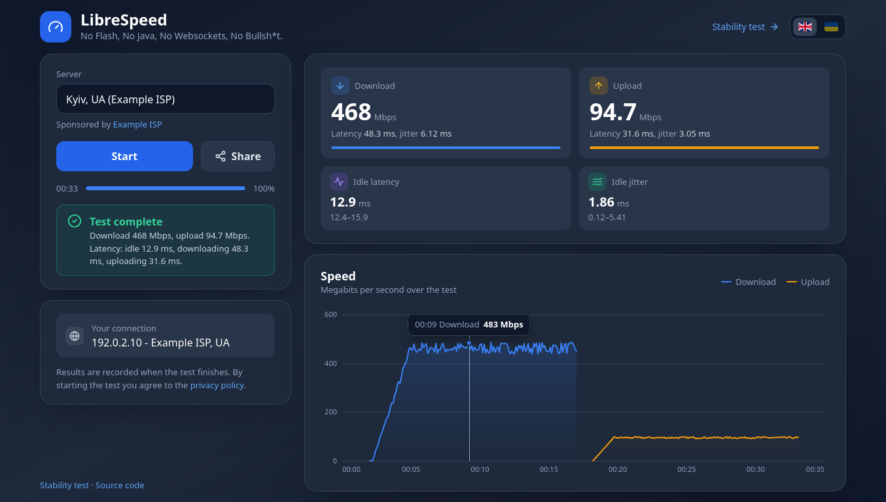
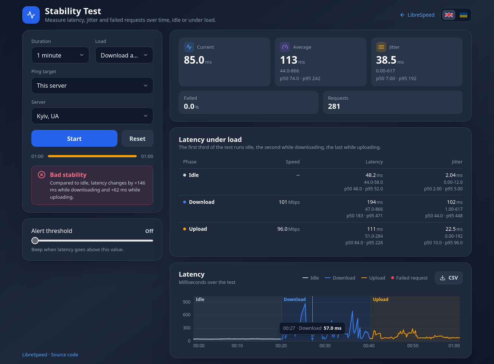
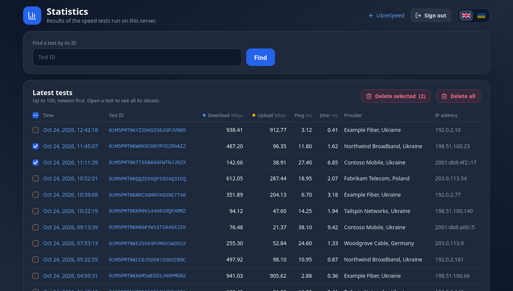
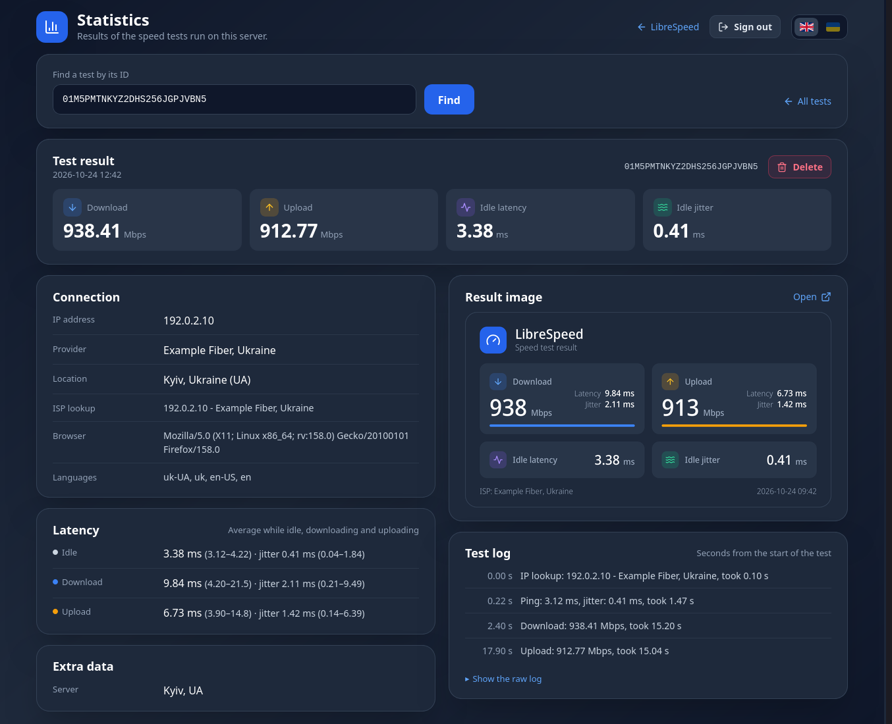

<picture>
  <source media="(prefers-color-scheme: dark)" srcset=".logo/logo2.png">
  
</picture>

# LibreSpeed

No Flash, No Java, No WebSocket, No Bullshit.

A self-hosted speed test in a single Go binary. The browser measures download, upload, ping and jitter with
XMLHttpRequest and Web Workers, and the web UI is built into the binary, so there is nothing else to install.

This is a fork of [librespeed/speedtest-go](https://github.com/librespeed/speedtest-go).



| Stability test | Statistics |
| --- | --- |
|  |  |

<details>
<summary>A single test on the statistics page</summary>



</details>

## Features

* Download and upload speed, ping and jitter, with a live speed chart
* IP address, ISP and country of the client
* Connection stability test (`/stability.html`): latency over time, jitter, failed requests, an alert threshold and
  CSV export
* Optional result storage, with a shareable result image, a JSON API and a password-protected statistics page
* Multiple test servers to choose from
* English and Ukrainian, picked from the browser's language or a switch on every page
* Layouts for desktop and phone
* Optional IP redaction for stored results
* Supports the [PROXY protocol](https://www.haproxy.org/download/2.3/doc/proxy-protocol.txt)
* Answers the PHP backend's endpoints too (`.php` suffixes and the `/backend/` prefix)

The pages work in current versions of Firefox, Chrome, Edge and Safari, on desktop and mobile.

## Installation

### Prebuilt binaries

1. Download the archive for your platform from the [releases](https://github.com/sprytnyk/speedtest-go/releases/)
   page and unpack it.
2. Edit `settings.toml` (see [Configuration](#configuration)).
3. Run `./speedtest-backend`. It reads `settings.toml` from the current directory, or the file given with
   `-c /path/to/settings.toml`. `./speedtest-backend -version` prints the version.

The test is then served at `http://<host>:8989/`.

### Docker

Images for `linux/amd64`, `linux/arm64`, `linux/arm/v7` and `linux/386` are published to the GitHub Container
Registry for every release, tagged with its version (e.g. `v1.3.0`) and `latest`:

```
docker run -d -p 8989:8989 ghcr.io/sprytnyk/speedtest-go:latest
```

The image contains the repository's `settings.toml`, which keeps results in memory. Change settings with
environment variables (e.g. `-e SPEEDTEST_DATABASE_TYPE=sqlite -e SPEEDTEST_DATABASE_FILE=/data/speedtest.db
-v speedtest-data:/data`), or mount your own file over `/app/settings.toml`.

### systemd

[`systemd/`](systemd/) has a hardened unit with socket activation and setup steps. Two things to know:

* `MemoryDenyWriteExecute=true` works with the release binaries, but not with binaries packed with UPX, which unpack
  themselves into executable memory.
* With `DynamicUser=true`, a SQLite or BoltDB file needs a writable place that survives restarts. Add
  `StateDirectory=speedtest` to the unit and set `database_file="/var/lib/speedtest/speedtest.db"`.

### From source

Go 1.27 or later is needed:

```
git clone https://github.com/sprytnyk/speedtest-go
cd speedtest-go
go build -ldflags "-w -s -X main.version=$(git describe --tags)" -trimpath -o speedtest-backend .
```

The web UI from `web/assets` is embedded in the binary, so `speedtest-backend` and `settings.toml` are all you need
to copy to the server.

`scripts/build-release.sh` builds the release archives and their `SHA256SUMS` for every platform into `dist/`. The
*Release builds* workflow runs it for every version tag, and from the Actions tab for any branch, and keeps the
archives as a downloadable artifact of the run. The builds are reproducible, so the same commit gives the same
checksums on any machine with the same Go toolchain.

## Configuration

Settings are read from `settings.toml`; the file in this repository lists every key with a comment. Each key can
also be set with an environment variable named `SPEEDTEST_` plus the key in capitals, e.g.
`SPEEDTEST_LISTEN_PORT=8080`, which takes precedence over the file.

| Key | Meaning |
| --- | --- |
| `bind_address`, `listen_port` | Where to listen. An empty address listens on all interfaces; the port defaults to 8989. |
| `url_base` | Path prefix when the test is served below the site root, e.g. `/librespeed`. |
| `proxyprotocol_port` | Extra port that expects the PROXY protocol, `0` to disable. |
| `assets_path` | Directory with your own copy of the web UI. When empty or missing, the built-in UI is used. |
| `ip_lookup_url` | ISP lookup API, see [ISP lookup and privacy](#isp-lookup-and-privacy). |
| `database_type` | Where results are stored: `none`, `memory`, `bolt`, `sqlite`, `mysql`, `postgresql` or `mssql`. |
| `database_file` | Database file for `bolt` and `sqlite`. |
| `database_hostname`, `database_port`, `database_name`, `database_username`, `database_password` | Connection settings for MySQL, PostgreSQL and MSSQL. `database_port` is only used by MSSQL. |
| `statistics_password` | Password of the statistics page. The page stays locked while it is `PASSWORD` or empty. |
| `redact_ip_addresses` | Store results without the client's IP address and hostname. |
| `enable_tls`, `enable_http2`, `tls_cert_file`, `tls_key_file` | Serve HTTPS directly. HTTP/2 needs TLS. |

### Multiple servers

To let users choose between test servers, put a `server-list.json` into your `assets_path` directory:

```json
[
  {
    "name": "Kyiv, UA",
    "server": "https://kyiv.example.com/",
    "dlURL": "garbage",
    "ulURL": "empty",
    "pingURL": "empty",
    "getIpURL": "getIP",
    "sponsorName": "Example ISP",
    "sponsorURL": "https://example.com/"
  }
]
```

The page pings every server and selects the closest. Without the file, the test runs against the server that
serves the page.

## Storing results

Results are stored when the page sends them at the end of a test. That gives every test an ID, the **Share** button
with a result image, and the statistics page. To turn it on:

1. Choose a database with `database_type`. `sqlite` is the simplest: it only needs `database_file`, and creates
   its tables itself.
2. Set `statistics_password` to open the statistics page at `/stats`.
3. Copy `web/assets` to a directory of your own, set `assets_path` to it, and add a `settings.json` there:

    ```json
    { "telemetry_level": "full" }
    ```

    `basic` stores the results only; `full` also stores the test log shown on the statistics page.
4. Put your contact address into the privacy policy in `index.html` (search for `PUT@YOUR_EMAIL.HERE`). The policy
   is shown to users before they start a test.

A stored test can then be read at:

* `/results/?id=<id>`: the result image, in Ukrainian with `&lang=uk`
* `/results/json?id=<id>`: the result as JSON
* `/stats`: the latest 100 tests, and every detail of a single test

### Databases

* **SQLite** and **BoltDB** need nothing but the file, and SQLite runs in WAL mode.
* For **PostgreSQL**, **MySQL** and **MSSQL**, create the database and import the schema from
  `database/{postgresql,mysql,mssql}`, e.g. `psql speedtest < database/postgresql/telemetry_postgresql.sql`.
* **MySQL** takes the Go driver's address format in `database_hostname`, not a bare hostname:

    ```toml
    database_hostname="tcp(db.example.com:3306)"        # TCP, port is required
    database_hostname="unix(/run/mysqld/mysqld.sock)"   # Unix socket
    database_hostname=""                                # TCP to 127.0.0.1:3306
    ```

    A bare value such as `localhost` fails at startup with `default addr for network 'localhost' unknown`.

* Results are looked up by `uuid`, so the schemas index that column. Databases created from an older schema need
  the index added by hand (SQLite gets it on startup):

    ```sql
    -- PostgreSQL
    CREATE INDEX speedtest_users_uuid_idx ON speedtest_users (uuid);
    -- MySQL
    CREATE INDEX speedtest_users_uuid_idx ON speedtest_users (uuid(26));
    -- MSSQL (nvarchar(max) columns cannot be indexed)
    ALTER TABLE speedtest_users ALTER COLUMN uuid nvarchar(64) NULL;
    CREATE NONCLUSTERED INDEX IX_speedtest_users_uuid ON speedtest_users (uuid);
    ```

## ISP lookup and privacy

The client's ISP and country come from the [ip.sprytnyk.dev](https://ip.sprytnyk.dev/openapi.json) API. Only the
client's IP address is sent: no API key, cookies or other identifiers. Private and special addresses (including
CGNAT and IPv6 ULA) are never sent. The client IP is taken from the connection, or from the `X-Forwarded-For`,
`X-Real-IP`, `Client-IP` and `CF-Connecting-IPv6` headers when a proxy sets them.

* To use another API, point `ip_lookup_url` at it. `{ip}` in the URL is replaced with the client's IP, and the
  response must be JSON with `ip`, `city`, `country`, `iso_code` and `org` fields.
* To turn lookups off for everyone, set `ip_lookup_url=""`. To turn them off in the web UI only, set
  `getIp_ispInfo: false` in its settings.

## Languages

The pages and the result image are in English and Ukrainian. The language follows the browser, and the flag switch
in the top bar changes it. The page texts live in `web/assets/javascript/i18n.js`, and the result image's labels in
`imageTexts` in `results/png.go`.

## Differences from the PHP backend

* Test IDs are random [ULIDs](https://github.com/ulid/spec) instead of auto-increment numbers, so they cannot be
  guessed, and `enable_id_obfuscation` is not needed and not supported.
* The ISP is looked up with an API (see above) instead of ipinfo.io or an offline GeoIP database, so no API key or
  `.mmdb` file is needed.
* The distance between client and server is not calculated, so `server_lat`, `server_lng`, `ipinfo_api_key` and
  `geoip_database_file` are not used.

## License

Copyright (C) 2016-2020 Federico Dossena
Copyright (C) 2020 Maddie Zhan
Copyright (C) 2026 Vladyslav Krylasov

This program is free software: you can redistribute it and/or modify
it under the terms of the GNU Lesser General Public License as published by
the Free Software Foundation, either version 3 of the License, or
(at your option) any later version.

This program is distributed in the hope that it will be useful,
but WITHOUT ANY WARRANTY; without even the implied warranty of
MERCHANTABILITY or FITNESS FOR A PARTICULAR PURPOSE.  See the
GNU General Public License for more details.

You should have received a copy of the GNU Lesser General Public License
along with this program.  If not, see <https://www.gnu.org/licenses/lgpl>.
