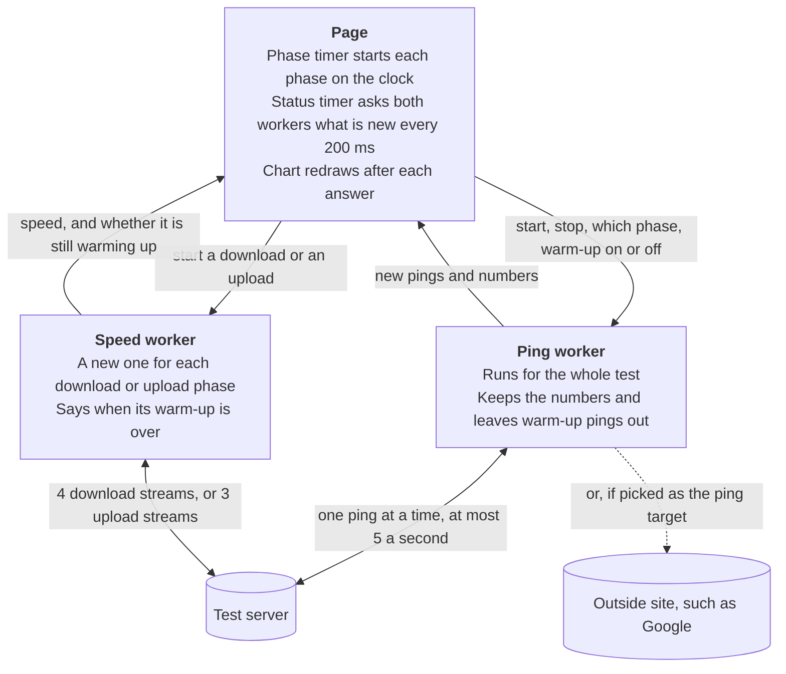
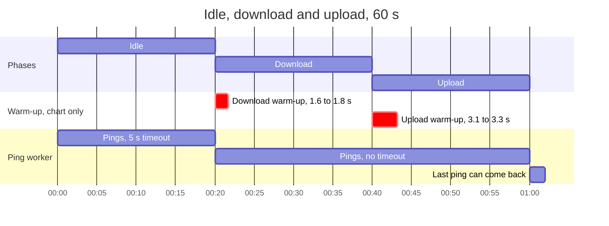
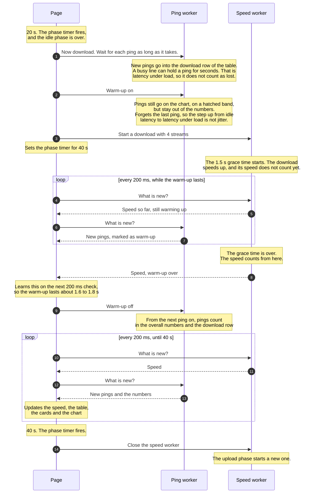
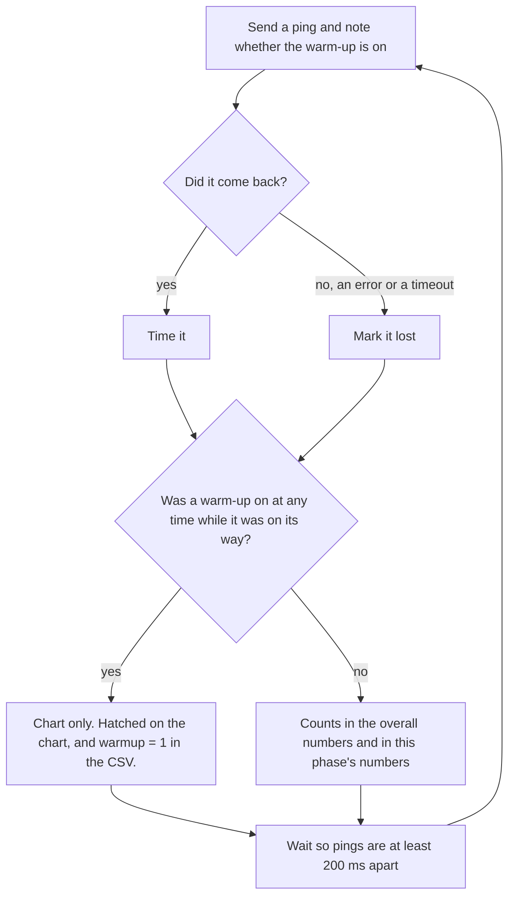

# How the stability test works

The stability test at `/stability/` pings the server for the chosen time and charts every ping. With a load picked, it
also downloads or uploads during part of the test, and shows the latency of each phase. This page shows how the parts
work together, with the 60 s test as the example.

## 1. The parts

The page is `web/assets/stability/index.html`. The ping worker is `stability_worker.js`, and the speed worker is
`speedtest_worker.js`. The speed test page uses both workers too. It runs its download and upload with the speed
worker, and measures the latency under load with the ping worker. So a change to either worker changes both pages.

The page sends the workers short text messages:

| Message | Sent to | What it means |
|---|---|---|
| `start {settings}` | both workers | Start, with these settings. |
| `status` | both workers | Send your latest state. The ping worker sends only the pings since the last time. |
| `phase 1 0` | ping worker | The download starts. Pings from now on go into the download row, and each waits as long as it takes. The 1 is the phase, the 0 is the ping timeout, and a timeout of 0 means none. |
| `phase 2 0` | ping worker | The upload starts. The same, for the upload row. |
| `warmup 1` | ping worker | The transfer is warming up. |
| `warmup 0` | ping worker | The warm-up is over. |
| `finish` | ping worker | The last phase is over. |
| `abort` | ping worker | The user pressed Stop. |

The ping worker starts in the idle phase, so the page never sends `phase 0`.

## 2. A 60 s test of idle, download and upload

With Load set to "Idle, download and upload", each phase gets a third of the time and starts on the clock. The warm-up
takes part of its phase, so the upload still stops at 60 s.

With Load set to Download or Upload, the test is one phase of the full 60 s, with its warm-up at the start. With Load
set to Idle, the page starts no phase timer and no speed worker, and the ping worker stops by itself at 60 s. A ping on
its way at 60 s still gets its 5 s timeout to come back, so an Idle test can run a little past 60 s.

## 3. The download phase

This is the middle phase of the 60 s test above.

The page never sets the warm-up length. It waits for the speed worker to say the warm-up is over, so the warm-up follows
`time_dlGraceTime` and `time_ulGraceTime`, the same grace times the speed test uses.

The upload phase, from 40 to 60 s, takes the same steps with two differences. Its grace time is 3 s, and the speed worker
sends one empty upload before it starts, so its warm-up lasts about 3.1 to 3.3 s. And it is the last phase, so at 60 s the test ends.

The ping worker sends one ping at a time and waits for its answer before it sends the next. So at 60 s a ping is
usually still on its way:

| Time | What happens |
|---|---|
| 59.8 s | The ping worker sends a ping while the upload runs. |
| 60.0 s | The phase timer fires. The page stops the upload and tells the ping worker to finish. |
| 60.7 s | The ping comes back, 900 ms. |

Pings stuck behind the upload are often the slowest ones, and this test is there to catch them. So the worker waits up
to 2 s for that ping. If it comes back in time, it counts in the upload row, because the worker sent it during the
upload. If it doesn't, the worker drops it, and it doesn't count as lost. Then the test stops. The speed test page gives
its last ping 2 s too.

If a transfer stops before its phase is over, the speed worker says it is finished, and the page starts the next phase
at once. This shouldn't happen. A stream that fails starts again, and each transfer is set to run longer than its phase.

## 4. What happens to each ping

A ping counts only if no warm-up was on at any time while it was on its way. Here the download's warm-up runs from
20 s to about 21.6 s:

| Ping | Sent | Answered | Counted | Why |
|---|---|---|---|---|
| A | 21.3 s | 21.5 s | no | It was sent and answered during the warm-up. |
| B | 21.5 s | 21.9 s | no | It was sent during the warm-up. |
| C | 21.9 s | 21.95 s | yes | It was sent after the warm-up. |
| D | 19.9 s | 20.2 s | no | It was answered during the warm-up. |
| E | 19.9 s | 21.7 s | no | The warm-up started and ended while it was on its way. |

Ping B spent most of its 400 ms stuck behind the warm-up. If the worker only checked the warm-up when the answer came
back, B would count, and a warm-up spike would go into the download numbers. Ping E took 1.8 s because the warm-up filled
the line. The warm-up was off both when E was sent and when it came back, but the worker counts the warm-ups, so it can
tell that one started in between.

Jitter is the average change from one counted ping to the next. Say the last idle ping is 20 ms and the first ping after
the download's warm-up is 60 ms. That 40 ms change is the step up to latency under load, and the phase table already
shows it as the difference between the idle and download rows. It isn't jitter. So when a warm-up starts, the worker
forgets the last ping, and the first ping after the warm-up has nothing to compare with.

## 5. The result message

The box above the chart rates the test Great, Good, Poor or Bad by the average latency, the jitter and the failed
requests. With a load, it rates each of the three by the worst phase.

With a load, the line under the rating compares each phase with idle. The first sentence gives the change in the middle
ping, the p50. The second gives the change in the p95, the time that 95% of the pings took or less. For example:

> Compared to idle, latency changes by +1.4 ms while downloading and +1.2 ms while uploading. For the slowest 5% of
> pings, it changes by +8 ms and +6 ms.

A few slow pings pull the average up but don't move the middle ping, so the middle ping shows the typical change. The
p95 shows how much slower the slowest pings get, and those are the pings that make calls stutter.

The worker works out p50 and p95 only once a phase has 20 counted pings. A 60 s test has 80 to 100 in each phase, but a
link that is very slow under load may never get there. Until every phase in the line has 20, the line compares the
averages and leaves out the second sentence. While the test runs, the line leaves the upload out until it has 20 pings.
Otherwise the download's numbers would switch back to averages for the upload's first seconds.
